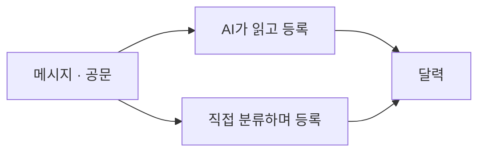
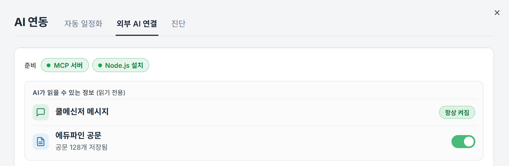

# HyperCool

쿨메신저로 받은 메시지와 공문을 달력 일정으로 정리해 주는 Windows 앱.


## 설치

[Releases](https://github.com/banatic/Hypercool/releases)에서 최신 `.msi`를 받아 설치합니다. Windows 10/11 64비트, 쿨메신저가 설치된 PC에서 동작합니다.

처음 실행하면 쿨메신저 메시지 파일(`.udb`)을 고릅니다. 보통 아래 경로에 있습니다.

```text
C:\Users\사용자명\AppData\Local\CoolMessenger\Memo\
```

## 달력에 일정이 들어오는 방법



### A. AI가 알아서 등록

새 메시지와 에듀파인 공문을 AI가 읽고, 마감이나 행사가 있으면 달력에 넣습니다. PC에 Claude Code나 Codex가 설치되어 있어야 합니다.


### B. 직접 분류하며 등록

받은 메시지를 하나씩 넘기며 완료와 할 일로 나누고, 할 일에 마감일을 붙이면 달력에 들어갑니다.


## AI에게 물어보기

Claude Desktop 같은 AI 앱을 HyperCool에 연결하면, 쌓인 메시지와 공문을 뒤져 대신 찾아 줍니다. 설정은 **AI 연동 → 외부 AI 연결 → 자동 설정하기** 한 번이면 됩니다.

- "가정통신문 중에 급식비 관련된 거 찾아줘"
- "이번 주에 제출해야 하는 공문 정리해 줘"
- "교무부에서 온 메시지 최근 10개 요약해 줘"



## 학교 위젯

시간표·급식·출결·상벌점을 탭으로 봅니다.


## 그 밖에

- 메시지 관리함 첨부파일 일괄 저장
- 쿨메신저 작성창 GIF 검색
- Google 로그인 시 일정 동기화와 웹에서 보기

## 개발

Node.js 18 이상과 Rust가 필요합니다.

```powershell
npm install
npm run tauri dev     # 개발 실행
npm test              # 테스트
npm run tauri build   # 설치 파일 생성
```

```text
src/                React 프런트엔드
src-tauri/          Rust 백엔드
src-firebase-app/   웹 컴패니언
pages/              위젯·보조 창 HTML
scripts/            릴리즈·파서 검증 스크립트
docs/               개발 문서
```
