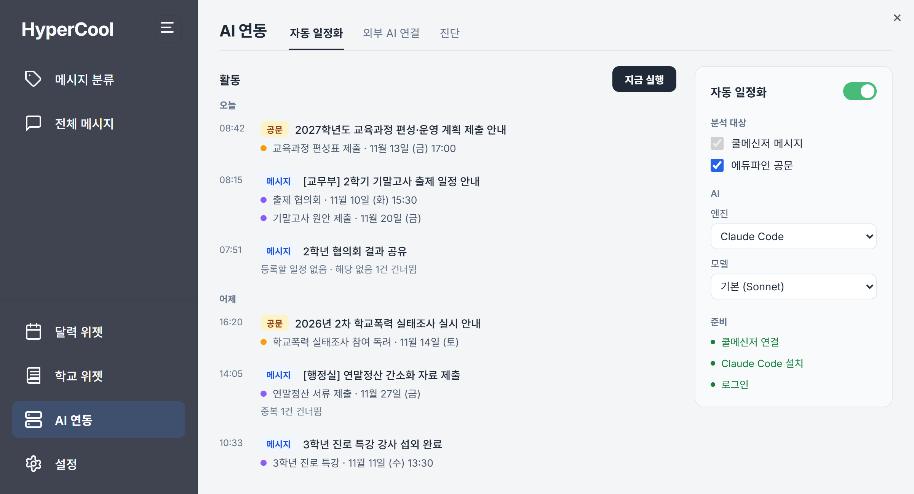
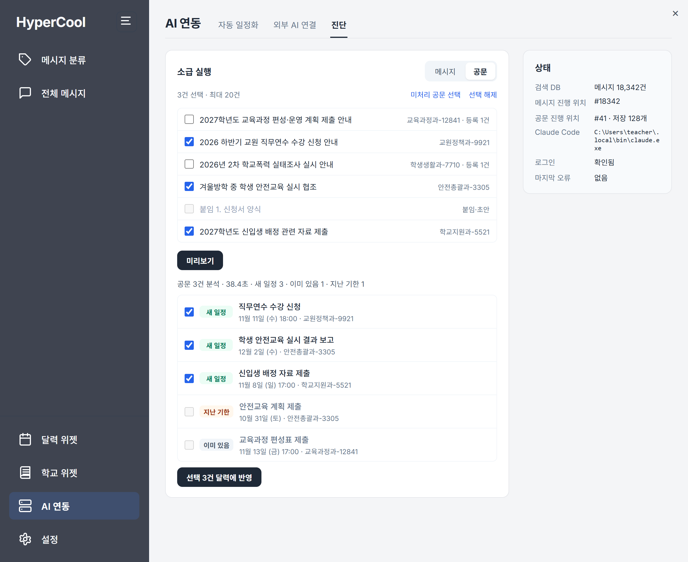
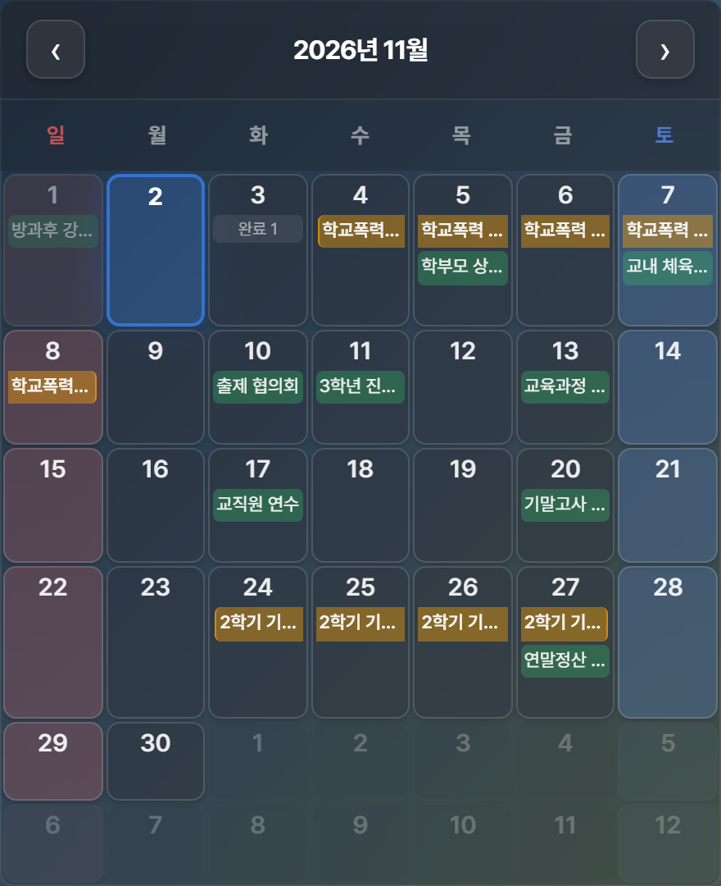
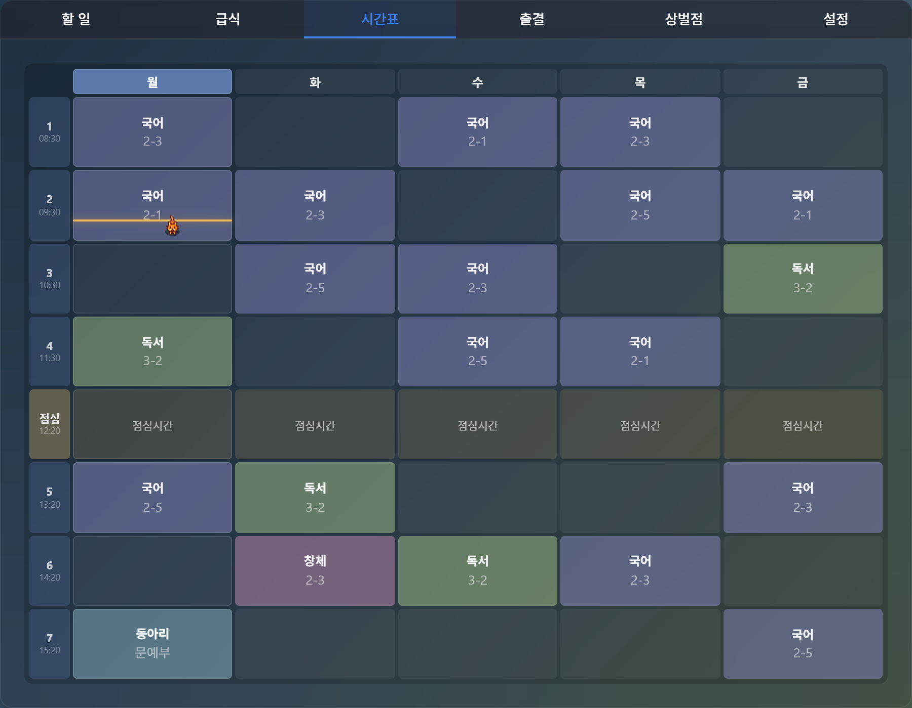

# HyperCool

쿨메신저로 받은 메시지와 공문에서 일정을 뽑아 달력에 정리해 주는 Windows 앱.



## 설치

[Releases](https://github.com/banatic/Hypercool/releases)에서 최신 `.msi`를 받아 설치합니다. Windows 10/11 64비트, 쿨메신저가 설치된 PC에서 동작합니다.

처음 실행하면 쿨메신저 메시지 파일(`.udb`)을 고릅니다. 보통 아래 경로에 있습니다.

```text
C:\Users\사용자명\AppData\Local\CoolMessenger\Memo\
```

## 기능

### AI 일정 정리

새 메시지와 에듀파인 공문을 AI가 읽고, 마감이나 행사가 있으면 달력에 일정으로 등록합니다. 이미 있는 일정은 건너뜁니다.

- 엔진: Claude Code 또는 Codex (PC에 설치·로그인 필요)
- 분석 대상: 쿨메신저 메시지, 에듀파인 공문
- 지난 메시지나 공문은 **진단 → 소급 실행**에서 미리 보고 골라서 반영



### 달력·학교 위젯

바탕화면에 띄워 두는 위젯입니다. 달력에는 일정과 할 일이, 학교 위젯에는 시간표·급식·출결·상벌점이 나옵니다.

| 달력 | 시간표 |
| --- | --- |
|  |  |

### 메시지 정리

받은 메시지를 완료와 할 일로 나누고, 마감일을 붙여 관리합니다. 본문 전체 검색을 지원합니다.


### 그 밖에

- 메시지 관리함 첨부파일 일괄 저장
- 쿨메신저 작성창 GIF 검색
- Google 로그인 시 일정 동기화와 웹에서 보기
- MCP 서버(`localhost:3737`)로 Claude Desktop 등에서 메시지·공문 검색

## 개발

Node.js 18 이상과 Rust가 필요합니다.

```powershell
npm install
npm run tauri dev     # 개발 실행
npm test              # 테스트
npm run tauri build   # 설치 파일 생성
```

```text
src/                React 프런트엔드
src-tauri/          Rust 백엔드
src-firebase-app/   웹 컴패니언
pages/              위젯·보조 창 HTML
scripts/            릴리즈·파서 검증 스크립트
docs/               개발 문서
```

릴리즈 절차는 [docs/release_method.md](docs/release_method.md)를 참고하세요.
